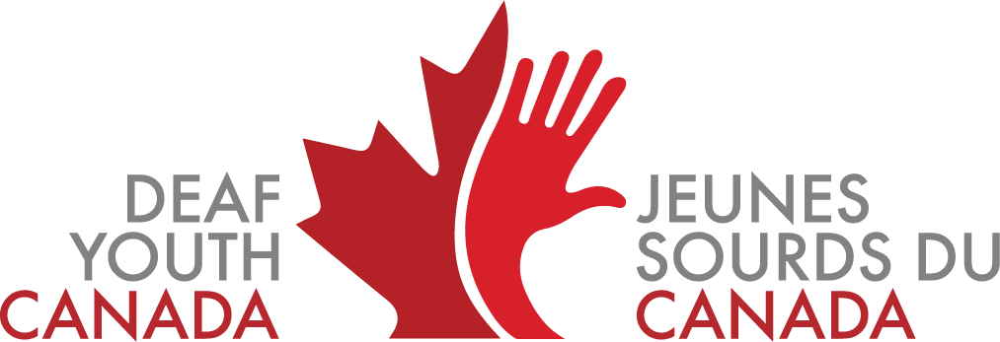

# Deaf Youth Canada / Jeunes Sourds du Canada

**By Youth • For Youth • About Youth**  
**Par les jeunes • Pour les jeunes • À propos des jeunes**

[dycjsc.ca](https://dycjsc.ca)

---

## About Us

**Deaf Youth Canada / Jeunes Sourds du Canada (DYC/JSC)** is a national organization serving Deaf youth across Canada between the ages of **18 and 30**.

DYC/JSC is led by Deaf youth and works to create opportunities for young people to connect, develop leadership skills, share experiences, and become actively involved in their communities.

Our work is built around three guiding principles:

**By Youth**  
DYC/JSC is governed and led by Deaf youth.

**For Youth**  
We bring Deaf youth together and create opportunities to build connections, exchange experiences, develop skills, and strengthen community.

**About Youth**  
We work to ensure Deaf youth are represented and included in conversations, initiatives, and organizations that affect their communities and their future.

---

## À propos de nous

**Deaf Youth Canada / Jeunes Sourds du Canada (DYC/JSC)** est une organisation nationale qui s'adresse aux jeunes Sourds de partout au Canada âgés de **18 à 30 ans**.

DYC/JSC est dirigé par des jeunes Sourds et vise à créer des occasions pour les jeunes de se rencontrer, de développer leurs compétences en leadership, de partager leurs expériences et de participer activement à leurs communautés.

Notre travail repose sur trois principes fondamentaux :

**Par les jeunes**  
DYC/JSC est gouverné et dirigé par des jeunes Sourds.

**Pour les jeunes**  
Nous rassemblons les jeunes Sourds et créons des occasions de tisser des liens, d'échanger des expériences, de développer leurs compétences et de renforcer la communauté.

**À propos des jeunes**  
Nous travaillons afin que les jeunes Sourds soient représentés et inclus dans les discussions, les initiatives et les organisations qui touchent leurs communautés et leur avenir.

---

## Canadian Deaf Youth Leadership Camp

The **Canadian Deaf Youth Leadership Camp / Camp de leadership des jeunes Sourds du Canada (CDYLC/CLJSC)** brings Deaf youth from across Canada together for a national leadership and community experience.

The camp gives participants the opportunity to:

- develop leadership skills;
- build friendships and lasting connections;
- exchange ideas and experiences;
- learn from other Deaf youth;
- become more involved in the Deaf community; and
- help develop the next generation of Deaf leaders in Canada.

CDYLC/CLJSC is an important part of DYC/JSC's work to connect and empower Deaf youth from across the country.

### Camp de leadership des jeunes Sourds du Canada

Le **Camp de leadership des jeunes Sourds du Canada / Canadian Deaf Youth Leadership Camp (CLJSC/CDYLC)** rassemble des jeunes Sourds de partout au Canada dans le cadre d'une expérience nationale axée sur le leadership et la communauté.

Le camp offre aux participants l'occasion de :

- développer leurs compétences en leadership;
- créer des amitiés et des liens durables;
- échanger des idées et des expériences;
- apprendre auprès d'autres jeunes Sourds;
- s'impliquer davantage dans la communauté Sourde; et
- contribuer au développement de la prochaine génération de leaders Sourds au Canada.

Le CLJSC/CDYLC constitue une partie importante du travail de DYC/JSC visant à rassembler et à soutenir les jeunes Sourds partout au pays.

---

## Our GitHub

This GitHub organization is the home of digital projects maintained by **Deaf Youth Canada / Jeunes Sourds du Canada**.

Our repositories may include:

- DYC/JSC websites and online services;
- CDYLC/CLJSC projects;
- community and event tools;
- public resources and documentation;
- accessibility-related projects; and
- internal tools used to support the organization.

Public repositories are maintained by DYC/JSC board members and authorized contributors.

Where community contributions are accepted, individual repositories may include their own contribution guidelines and documentation.

---

## Notre GitHub

Cette organisation GitHub regroupe les projets numériques maintenus par **Deaf Youth Canada / Jeunes Sourds du Canada**.

Nos dépôts peuvent comprendre :

- les sites Web et services en ligne de DYC/JSC;
- les projets du CDYLC/CLJSC;
- les outils communautaires et événementiels;
- les ressources et la documentation publiques;
- les projets liés à l'accessibilité; et
- les outils internes utilisés pour soutenir l'organisation.

Les dépôts publics sont maintenus par les membres du conseil d'administration de DYC/JSC et les contributeurs autorisés.

Lorsque les contributions de la communauté sont acceptées, les dépôts concernés peuvent contenir leurs propres directives et documents de contribution.

---

## Connect With Us

**Website:** [dycjsc.ca](https://dycjsc.ca)  
**Instagram:** [@dyc.jsc](https://www.instagram.com/dyc.jsc/)  
**Facebook:** [facebook.com/dyc.jsc](https://www.facebook.com/dyc.jsc)

## Suivez-nous

**Site Web :** [dycjsc.ca](https://dycjsc.ca)  
**Instagram :** [@dyc.jsc](https://www.instagram.com/dyc.jsc/)  
**Facebook :** [facebook.com/dyc.jsc](https://www.facebook.com/dyc.jsc)

---

### Deaf Youth Canada / Jeunes Sourds du Canada

**By Youth • For Youth • About Youth**  
**Par les jeunes • Pour les jeunes • À propos des jeunes**

[dycjsc.ca](https://dycjsc.ca)

